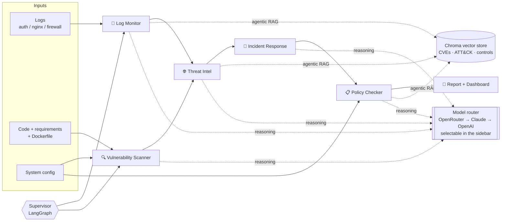

# Cyber Security AI Agent (SecAgents) : A Multi-Agent Cyber Security AI system (Common Vulnerabilities and Exposures (CVE))


## Overview:

**What it is:** 

SecAgents is a multi-agent cyber security assistant powered by **Five AI agents (Log Monitor, Threat Intelligence, Vulnerability Scanner, Incident Response and Policy Checker)** work together to find attacks, check whether you're affected, and tell you what to fix.

**How it works:** 

A **LangGraph** supervisor runs the agents in dependency order, and **Agentic RAG** grounds them in **CVE, MITRE ATT&CK and NIST / ISO 27001 / SOC 2** knowledge. Detection is rule-based first, with an LLM adding narrative and remediation. It works with **OpenRouter, Claude or OpenAI**, with automatic fallback, and still runs fully offline with no API key.

**What you get:** 

An assessment from your logs, code, dependencies, Dockerfile and config. It covers a prioritized incident playbook (NIST SP 800-61), compliance scores per framework, and a report you can download as **Word, Excel, PDF, Markdown or JSON**.

**Real-time:** 

The **Streamlit** dashboard has a Live scan that follows log files as they grow and alerts the first time each attack appears. It also has a Simulation mode and a paste box for trying attack lines.

**Where it runs:** 

The dashboard runs on a long-lived **Streamlit** host and the project has 74 tests.


| Agent | What it does |
|---|---|
| 📜 **Log Monitor** | Parses auth, web and firewall logs. Detects brute force and password spraying, login-after-brute-force, privilege escalation, backdoor accounts, SQLi / path traversal / XSS / command injection / Log4Shell, scanners, port scans and outbound C2 traffic. Maps each detection to MITRE ATT&CK and writes an attack narrative. |
| 🔍 **Vulnerability Scanner** | Runs Bandit SAST on code, finds hardcoded secrets, lints the Dockerfile (EOL base image, root user, secrets in ENV...), builds a software inventory, uses Trivy if installed, and suggests code fixes. |
| 🌐 **Threat Intelligence** | Answers *"are we affected?"*: version-matches the inventory against CVEs, uses agentic RAG to identify which CVE an exploit attempt targets and whether that component is deployed, correlates attacks in the logs with weaknesses in the code, and checks IOCs. |
| 🚨 **Incident Response** | Declares prioritized incidents and generates a NIST SP 800-61 playbook (analysis, containment, eradication, recovery, post-incident) with concrete commands for the actual attacker IPs, accounts and hosts. |
| 📋 **Policy Checker** | Evaluates 20 technical checks against 40 controls in NIST 800-53, NIST CSF 2.0, ISO 27001:2022 and SOC 2; scores each framework and writes a remediation roadmap ranked by how many controls each fix closes. |


## Architecture



- **Supervisor graph** (`secagents/graph.py`): a LangGraph `StateGraph` where a supervisor node routes to whichever agent's dependencies are satisfied, then hands off to the reporter.
- **Agentic RAG** (`secagents/rag/`): retrieve from Chroma, let the LLM grade relevance, rewrite the query and retry once. Embeddings use OpenAI when a key is set, otherwise a local hashed embedding.
- **Model router** (`secagents/llm.py`): tries providers in `LLM_PROVIDER_ORDER` (default `openrouter,anthropic,openai`); the sidebar **LLM provider** dropdown (default OpenRouter) moves the chosen one to the front and shows its model from `.env`. Claude calls use `claude-opus-5-5` with server-side refusal fallbacks, so security content that trips a classifier is rerouted instead of failing.
- **Deterministic first, LLM second**: every agent detects with explainable rules, then uses the LLM for correlation, narrative and remediation. With no keys the whole pipeline still runs.

## Quick start

```bash
Rename the .env.example file to .env and configure your APIKey.
python -m venv .venv && source .venv/bin/activate
pip install -r requirements.txt
cp .env.example .env        # add ANTHROPIC_API_KEY / OPENAI_API_KEY / OPENROUTER_API_KEY

streamlit run app/streamlit_app.py     # dashboard
python -m secagents --json results.json  # CLI: writes security_report.md (add --docx r.docx --xlsx r.xlsx --pdf r.pdf)
pytest                                  # 138 tests, no API keys needed
```

The CLI accepts your own data: `python -m secagents --logs /var/log/auth.log access.log --code ./src --requirements requirements.txt --dockerfile Dockerfile --config my_config.yaml`.
The dashboard also has an **Upload my own files** mode, a **Scan a whole folder or repository** option (type a local path, a Windows network share, a GitHub link or a public Google Drive folder link, or press **Browse...** for a local folder; the source's `.gitignore` / `.ignore` entries are pre-filled into an editable, comma-separated exclude box) and an **Ask** tab for questions such as *"Are we affected by Log4Shell?"*.

**Live scan** (switch under *Run assessment*): keeps watching the logs instead of analysing them once. Every few seconds it reads only the new lines of each log file, re-runs the Log Monitor's rules (no LLM, so it is cheap), and raises an alert the first time each attack appears; the same attack is never alerted twice. It also refreshes the whole dashboard: all five agents run once when Live scan starts (so the Incidents, Log detections, Code & config findings and CVE counters exist straight away) and again on every new alert, at most every 20 seconds. These refreshes are rule-based by default (seconds, no model calls; tick *Use the LLM* for LLM-written text) and each is saved to Scan history. The live panel shows the same counters as the Overview tab. Three ways to feed it:

- **🎬 Simulation mode** (switch shown once Live scan is on): replays the existing demo logs gradually as a simulated live feed. Nothing to set up.
- **Test it: paste log lines** (default when Simulation is off): follows the `live_logs/` folder (`LIVE_LOGS_DIR` to move it). Paste attack lines into the sidebar box and press **Append to log** (the default **Auto-detect** sends each line to `auth.log`, `nginx_access.log` or `firewall.log` by what it looks like, so you cannot pick the wrong file), or append to those files yourself. Copy-paste examples are in [`samples/live_examples/`](samples/live_examples/README.md).
- **A folder path**: enter a **Repository folder path** and its real log files are followed. Files uploaded in the browser are fixed copies and cannot be followed.

Existing log content is treated as the baseline, so switch Live scan on first; only activity after that raises alerts.

**Scan status at a glance:** a banner tops the dashboard. It is a calm still image (agents, shield and green code lines) when idle and an animated GIF (radar sweep, data packets flowing from the agents into the shield, and a green scan bar moving top to bottom that lights up the green code lines behind it) while a scan is running: *Run assessment*, Live scan, or Simulation. Beside the **Live scan** switch, a status dot is **red and still** when idle and **green and pulsing** while scanning. Regenerate the artwork with `python scripts/make_banner.py`.

Every assessment is saved to `.history/` (set `HISTORY_DIR` to move it) and listed under **Scan history** in the sidebar, using the name you give it or an automatic one (source, time, risk). Click a scan to reopen it. **Reset**, under the title, clears the current results, chat and inputs; saved history is kept.

## The demo scenario

`samples/` contains a seeded attack story (regenerate with `python samples/generate_logs.py`):

1. `192.0.2.77` port-scans the server, runs sqlmap and Nikto, then tries SQL injection, path traversal, command injection, XSS and a Log4Shell JNDI string.
2. `203.0.113.45` brute-forces SSH, logs in as `admin`, runs a root shell, creates a UID 0 user `sysupdate` and downloads a script from `203.0.113.99`.
3. The server opens a connection to `203.0.113.99:4444` and sends 48 MB out.

`samples/vulnerable_app` is a deliberately vulnerable Flask app with old dependencies and a bad Dockerfile, and `samples/config/system_config.yaml` describes the environment's security settings.

Expected outcome: overall risk **CRITICAL**, 3 incidents (SSH compromise P1, web exploitation P1, vulnerable components P2), the SQL injection, path traversal and command injection attacks matched to the exact vulnerable lines in `app.py`, Log4Shell correctly reported as *attempted but not affected*, 9 CVEs in the inventory, and compliance scores between roughly 20% and 45%.

## Project layout / Tech Stack:

```
secagents/
  agents/        log_monitor, vuln_scanner, threat_intel, incident_response, policy_checker
  rag/           Chroma knowledge base + agentic retriever
  graph.py       LangGraph supervisor
  llm.py         Claude / OpenAI / OpenRouter router
  repo_scan.py   Folder scan: ignore rules, exclusions, staging
  sources.py     Local / network share / GitHub / Google Drive sources, safe download and unpacking
  live.py        Live scan: log tailer, alert de-duplication, demo replay, live_logs/ helpers
  report.py      Markdown report
  exporters.py   Word / Excel / PDF exports of the same report data
  qa.py          Ask-the-agents Q&A
knowledge/       cves.jsonl, attack.jsonl, controls.jsonl, threat_feed.json
samples/         demo logs, vulnerable app, system config, live_examples/ (paste-in attack lines)
app/             Streamlit dashboard (assets/: banner still PNG and scanning GIF)
scripts/         make_banner.py regenerates the banner images
tests/
```

## Extending

- **More CVEs**: append to `knowledge/cves.jsonl` (`affected` takes specifiers like `>=2.0,<2.15.0`), or load an NVD export into the same shape.
- **New detections**: add a parser or rule in `secagents/agents/log_monitor.py`.
- **New controls**: add a line to `knowledge/controls.jsonl` naming the checks that evidence it, and a check in `policy_checker.py` if needed.

> All IP addresses are from RFC 5737 documentation ranges. The vulnerable app exists only to be scanned: do not deploy it.
> Note: Update the latest CVEs from:

https://www.cve.org/

https://nvd.nist.gov/vuln 

https://www.cisa.gov/known-exploited-vulnerabilities-catalog 

## Requirements checklist

Requirement: *an AI-powered cybersecurity system made of multiple agents that monitor logs, find security issues and suggest fixes automatically, showing how RAG and AI agents work together for threat detection, analysis and response.*

| # | Requirement | Status | Where / how |
|---|---|---|---|
| 1 | **Log Monitor Agent**: reads system and network logs, detects unusual activity or attacks | ✅ | `agents/log_monitor.py`: auth, web and firewall logs; brute force, spraying, privilege escalation, backdoor accounts, web attacks, scanners, port scans, C2 traffic; MITRE ATT&CK mapping |
| 2 | **Threat Intelligence Agent**: looks up known threats (CVE data, reports) | ✅ | `agents/threat_intel.py`: CVE and ATT&CK knowledge base (`knowledge/`), IOC feed, agentic RAG |
| 3 | ...and checks if your system is affected | ✅ | Version-matches the software inventory against CVEs and correlates log attacks with weaknesses in the code |
| 4 | **Vulnerability Scanner Agent**: scans code | ✅ | Bandit SAST, regex fallback rules, hardcoded-secret scan |
| 5 | ...scans Docker images | 🟡 | Dockerfile lint (EOL base image, root user, secrets in `ENV`, unpinned tags) and dependency CVEs. Trivy runs on the source folder when installed. A built image is not pulled or scanned |
| 6 | ...scans APIs | 🟡 | The API's source code is scanned, and attacks on it are found in access logs. No live endpoint or OpenAPI spec scanning |
| 7 | **Incident Response Agent**: step-by-step action plans when an issue is found | ✅ | `agents/incident_response.py`: prioritized incidents and a NIST SP 800-61 playbook with commands for the actual IPs, accounts and hosts |
| 8 | **Policy Checker Agent**: checks setup against ISO, NIST, SOC 2 | ✅ | `agents/policy_checker.py`: 20 checks, 40 controls across NIST 800-53, NIST CSF 2.0, ISO 27001:2022, SOC 2 |
| 9 | ...and shows where you need fixes | ✅ | Per-control PASS / PARTIAL / FAIL, framework scores, gaps ranked by controls closed, remediation roadmap |
| 10 | Multiple agents working together | ✅ | LangGraph supervisor (`graph.py`) runs agents in dependency order |
| 11 | RAG and agents working together | ✅ | Chroma store with an agentic retriever that grades results, rewrites the query and retries (`rag/`) |
| 12 | Real-time threat detection, analysis and response | ✅ | **Live scan** switch next to *Run assessment*: follows the log files as they grow, alerts the first time each attack appears and refreshes the full agent pipeline and dashboard counters on new alerts (`live.py`). It runs while the dashboard is open; it is not a background service |
| 13 | Suggest fixes automatically | ✅ | Code fix suggestions, incident playbook, compliance roadmap, all LLM-written with rule-based fallbacks |
| 14 | Useful for security engineers, DevOps and IT teams | ✅ | Streamlit dashboard, CLI (`python -m secagents`), report export to Word, Excel, PDF, Markdown and JSON, folder scan, scan history |

✅ implemented · 🟡 partly implemented · ❌ not implemented

## FAQs

### General

**What does this project do?**
It runs five cooperating AI agents over your logs, code, dependencies, Dockerfile and system config. They detect attacks, check whether known CVEs affect you, scan for weaknesses, plan the incident response and score compliance, then produce one report and a dashboard.

**Who is it for?**
Security engineers, DevOps and IT teams who want to see how GenAI can automate triage, analysis and remediation planning.

**Do I need an API key?**
No. Every agent detects with rule-based logic first and uses the LLM only for correlation, write-ups and suggestions. With no key (or `SECAGENTS_OFFLINE=1`) the whole pipeline still completes, with plainer text. Any one of the three providers is enough.

**What happens in the dashboard when no API key is found?**
If the selected provider has no key, neither typed in the **API key** box nor in `.env`, the sidebar shows a red error ("No API key found for <provider>…"), a toast appears (once per provider, not on every rerun), and the key box gets a red outline. The message also says what will happen: it names the fallback provider if another one has a key, otherwise that the agents run in rule-based mode. It is a warning, not a block: **Run assessment** still works. The alert clears as soon as you type a key or add one to `.env`. With `SECAGENTS_OFFLINE=1` there is no alert, because running without a model is then a deliberate choice.

**Is it an audit or a certified scanner?**
No. It is a demonstration. Detections, the CVE list (16 entries) and the control library (40 controls) are small, curated and indicative. Do not use the scores as audit evidence.

### The agents

**How do the agents work together?**
A LangGraph supervisor runs whichever agent has its dependencies satisfied: Log Monitor and Vulnerability Scanner first, then Threat Intelligence (needs both), then Incident Response, then Policy Checker, then the reporter.

**How does the Log Monitor detect attacks?**
It parses auth, web and firewall logs and applies explainable rules: failed-login bursts, a successful login after brute force, privilege escalation, new UID 0 accounts, SQLi / path traversal / XSS / command injection / Log4Shell strings, scanner user agents, port scans and large outbound transfers. Each event gets MITRE ATT&CK IDs and evidence lines.

**How does Threat Intelligence decide "are we affected?"**
It version-matches the software inventory (from `requirements.txt` and the config) against CVE records. For exploit attempts in the logs, agentic RAG identifies the CVE being targeted and checks whether that component is actually deployed. Log4Shell in the demo is reported as *attempted but not affected* because the app doesn't use Log4j.

**What does the Vulnerability Scanner cover?**
Python code (Bandit, plus regex rules for what Bandit misses), hardcoded secrets, Dockerfile problems, and a dependency inventory. Trivy results are added when the `trivy` binary is installed.

**Can it scan Docker images or APIs?**
Partly. It lints the Dockerfile and scans the source. It does not pull or scan a built image, and it does not probe a running API or read an OpenAPI spec. API attacks are still detected from access logs.

**What does the Incident Response Agent produce?**
Prioritized incidents (P1, P2...) and a NIST SP 800-61 playbook covering analysis, containment, eradication, recovery and post-incident, with commands built from the real attacker IPs, accounts and hosts. Steps marked 🤖 were suggested by the LLM.

**How does the Policy Checker score compliance?**
Each control lists the technical checks that evidence it. A control is PASS if all its checks pass, PARTIAL if some fail and FAIL if all fail. A framework score is `100 x (pass + 0.5 x partial) / total`. Failed checks become gaps ranked by how many controls each one blocks. Checks read your config YAML plus the other agents' findings, so a hardcoded secret fails the secrets controls.

**Why do config-based checks fail when I upload no config?**
They need a system-configuration YAML (see `samples/config/system_config.yaml`). Without one they report "could not evaluate" and count as failed.

### RAG and LLMs

**Where is RAG used?**
Threat Intelligence (CVE and ATT&CK lookup), the Policy Checker (control text for the biggest gaps) and the **Ask** tab. The retriever queries Chroma, has the LLM grade the hits, rewrites the query and retries once if they are poor.

**Which embeddings does it use?**
OpenAI embeddings when an OpenAI key is available, otherwise a local hashed embedding, so RAG also works offline. The key typed in the dashboard (for the OpenAI provider) wins over `OPENAI_API_KEY` in `.env`. Typing, changing or clearing it switches the knowledge base on the next agent run: Chroma keeps separate collections per backend, so the OpenAI collections are built once, kept on disk and only topped up afterwards, and clearing the key returns to `.env` (or local). A key that fails (wrong or unreachable) falls back to local embeddings and is not retried until it changes. The sidebar shows which embeddings are in use.

**Can retrieval fail while Chroma builds its index?**
Chroma can briefly report "Nothing found on disk" for a brand-new collection, depending on timing and threads. Retrieval retries and then falls back to an exact similarity search over the stored vectors (same ranking, the knowledge base is tiny), so an agent run never fails on it.

**Which LLM providers are supported and how does fallback work?**
OpenRouter, Anthropic (Claude) and OpenAI. The default order is `openrouter,anthropic,openai` (`LLM_PROVIDER_ORDER`). If a provider has no key, fails or refuses, the next one is tried; if all fail, the agent uses its rule-based output.

**Can I enter an API key in the dashboard instead of `.env`?**
Yes. Under the **LLM provider** dropdown there is an **API key for <provider>** box (masked). A key typed there is used first for that provider; if the box is empty the key from `.env` is used, so `.env` stays the fallback. Each provider remembers its own box, switching the dropdown never sends one provider's key to another, and a caption says whether the typed key or the `.env` key is in use. The key lives only in your browser session and the app's memory: it is never written to disk, Scan history or the report. An **OpenAI** key typed there also drives the RAG embeddings (see below); keys for other providers only affect chat.

**How do I choose the provider and model?**
Use the **LLM provider** dropdown in the sidebar (default OpenRouter). The chosen provider is tried first and the others stay as fallbacks. The sidebar shows each provider's model, taken from `CLAUDE_MODEL`, `OPENAI_MODEL` and `OPENROUTER_MODEL` in `.env`.

**Why might security content be refused by Claude?**
Cyber content can trip provider classifiers. Claude calls use server-side refusal fallbacks, and the router also falls through to the next provider.

### Using the dashboard and CLI

**How do I run it?**
`streamlit run app/streamlit_app.py` for the dashboard, `python -m secagents --json results.json` for the CLI, which writes `security_report.md`. Restart Streamlit after pulling code changes, because it keeps imported modules in memory.

**How do I scan my own system?**
Pick **Upload my own files** and upload logs, code, `requirements.txt`, a Dockerfile and a config, or use **Scan a whole folder or repository**: type a path or link (see below) or press **Browse...**. The scan finds logs, Python code, requirements, a Dockerfile and a config automatically.

**Which folders and links can I scan?**
Type any of these in **Repository folder path or link**:

| You type | What happens |
|---|---|
| `C:\projects\my-app` | A folder on the machine running the dashboard. |
| `\\server\share\folder` | A Windows network share, read in place. The dashboard must run on Windows; on Linux or macOS mount the share and enter the mount point. An unreachable share gives an error after 8 seconds instead of freezing the page. |
| `https://github.com/owner/repo` or `.../tree/<branch>/<folder>` | The repository (or just that folder) is downloaded as a zip. Public repos need nothing; for a private repo a **GitHub token** box appears (or set `GITHUB_TOKEN` on the server). |
| `https://drive.google.com/drive/folders/<id>` | A public Google Drive folder (shared as *Anyone with the link*). Only the files the scanners read are fetched (code, config, logs, requirements, Dockerfiles, ignore files), skipping anything your `.gitignore` excludes. |

Downloads are cached for 15 minutes, so changing a setting does not download again. A GitHub or Drive scan is a **snapshot**: Live scan can analyse it once but cannot watch it grow, so for live monitoring use a local folder or a network share. Private Drive folders are not supported (Google needs a login), and Google may throttle repeated downloads of the same folder. The first Drive fetch of a folder with around 100 files takes about a minute.

**Is it safe to point the scanner at a link I do not control?**
Downloaded content is treated as untrusted. Archives are unpacked with checks that block `..` and absolute paths, symlinks are skipped, and limits apply (150 MB download, 400 MB unpacked, 20,000 files; 300 files and 100 MB from Drive). Only GitHub and Google hosts are contacted, redirects away from GitHub are refused, and a GitHub token is only ever sent to `api.github.com`. Nothing from the source is executed; it is only read and scanned.

**What does the folder scan skip?**
`.git`, plus everything in the folder's `.gitignore` and `.ignore`. Those entries are pre-filled into the **Exclude folders** box (the label says so) whenever you pick a folder, so you can see exactly what is skipped. Add your own comma-separated names, relative paths or wildcards (for example `tests, docs, build`), or delete an entry to scan it after all. If the folder has no ignore file, add `.venv` and `node_modules` yourself.

**Does the Browse button work on a remote server?**
It opens the folder chooser on the machine running Streamlit. That is fine locally; on a remote host, type the path instead.

**Can I download the report as Word, Excel or PDF?**
Yes. The **📝 Report** tab has **Word (.docx)**, **Excel (.xlsx)**, **PDF**, **Markdown** and **JSON** buttons, and the CLI takes `--docx`, `--xlsx` and `--pdf` paths. All formats are built from the same data as the Markdown report, so the numbers match. Files are generated when you click, so the page stays fast.
- **Word and PDF** (landscape A4): executive summary, the incident briefing, then each agent's section with colour-coded tables (severity cells are red / orange / yellow / blue), the playbook, framework scores, ranked fixes and the controls that are not passing. Word headers repeat on every page of a long table; the PDF has page numbers.
- **Excel**: one sheet per table (Summary, Detections, CVEs, Attack correlation, Exploit attempts, IOCs, Findings, Incidents, Playbook, Compliance, Fixes, Control gaps, Checks, Inventory) plus a Narrative sheet. It has more columns than the documents (evidence, first/last seen, snippets, rules), frozen header rows, filters, colour-coded severities, and numbers stay numeric so you can sort and pivot.

**Is it safe to open exports that contain log text?**
Report text comes from logs and code, which attackers can influence, so exports treat it as untrusted: Excel cells that start with `=` are stored as plain text and can never run as formulas, control characters are stripped (they make Word files invalid), and PDF markup is escaped. The PDF uses standard fonts, so emoji and a few symbols are replaced or dropped there; Word and Excel keep them.

**Where are results stored?**
Each assessment is saved in `.history/` (change with `HISTORY_DIR`) and appears under **Scan history**. **Reset** clears the current view but keeps history.

**What can I ask in the Ask tab?**
Questions such as "Are we affected by Log4Shell?" or "What should we do in the next hour?". The question is routed to the relevant agents' results and grounded with RAG.

### Accuracy and limits

**Is this real-time?**
Yes, in the dashboard's **Live scan** mode: it polls the log files every 2 to 30 seconds (default 5), analyses only the new lines and alerts as soon as a new attack appears. It is polling, not an event stream, so alerts lag by up to one interval. It runs only while the dashboard page is open; it is not a background service, so close the page and monitoring stops. Without Live scan, each *Run assessment* analyses the logs once.

**How do I use Live scan?**
Switch on **Live scan** under *Run assessment*. Turn on **🎬 Simulation mode** to watch the demo logs replayed as a live feed. Leave it off to follow real files: either the `live_logs/` folder (paste attack lines from `samples/live_examples/` into the sidebar's **Test it** box) or, if you enter a **Repository folder path**, that folder's `.log` files. Browser uploads cannot be followed because they are fixed copies. Switching Live scan or Simulation off and on starts again from scratch.

**What do the banner and the red/green dot mean?**
Both show whether a scan is running. Idle: still banner and a red dot. Scanning (an assessment is running, or Live scan or Simulation is on): animated banner and a pulsing green dot.

**What can I paste to test Live scan?**
You do not have to paste anything: in the sidebar's **Test it** box pick an example under **Add a ready-made attack** and press **⚡ Add example**. There are three examples (their log lines are the `.txt` files in `samples/live_examples/`): an SSH brute force that ends in a compromise and a backdoor account, a set of web attacks, and a port scan with large outbound traffic. Together they raise 14 alerts. If you copy lines yourself, copy the contents of those `.txt` files. Descriptive text from a README is not log data: pasted into the box it gives "None of the pasted text looks like log lines", and typed straight into a live log it shows up as ignored lines that **🧹 Fix the live logs** removes.

**Does Live scan alert on attacks that are already in the logs?**
No. Existing content is the baseline; only attacks that appear after you switch it on raise alerts. Run an assessment first if you also want the existing history analysed.

**Will it spam me or run the LLM constantly?**
No. Detection is rule-based (no LLM calls) and each attack is alerted once, even as more matching lines arrive. Dashboard refreshes (all five agents) run when Live scan starts and on new alerts, at most every 20 seconds, and are rule-based unless you tick *Use the LLM for these refreshes*. Untick *Refresh the dashboard on new alerts* to get alerts only.

**I pasted some log lines and the panel says "Lines read 6, Detections 0". Why?**
Reading a line and detecting an attack are different things, and the live panel tells you which case you are in:
- **The lines were understood but do not add up to an attack yet.** The rules look for patterns, e.g. 10+ failed SSH logins from one IP, a web request carrying SQL injection or Log4Shell, a root-level account being created, or a port scan across 10+ ports. The panel shows progress ("6 failed SSH logins from 203.0.113.45 so far; a brute-force alert is raised at 10") and the line counts per file ("auth.log: 6 read, 6 understood"). Paste more, or the full files in `samples/live_examples/`.
- **The lines are in the wrong file.** For example firewall lines pasted into `auth.log` are read but ignored by that file's parser. The panel warns ("auth.log: 6 line(s) are ignored. 6 look like firewall.log lines…") and so does the paste box. Use **Auto-detect**, which routes every line to the right file for you.
- **The lines are in a format the detectors do not know.** The supported formats are classic syslog (`Oct 10 11:20:01 host sshd[1]: …`), nginx/Apache combined access logs, and UFW firewall lines. Modern ISO-8601 timestamps (`2026-10-11T10:00:01+00:00 host sshd[1]: …`) are **not** supported yet. Auto-detect refuses such lines and shows the expected formats, and a file that already contains them shows the same warning.
- **The lines are not log data at all.** Text copied from a README or a description (for example "SQL injection, path traversal, XSS…") is read but no parser understands it, so you get "N line(s) are not in a format the detectors understand" for that file. Press **🧹 Fix the live logs** under the warning: it keeps the lines the detectors read, **moves** lines that belong in another log (a firewall line in `auth.log` goes to `firewall.log`, and then counts), and removes the rest. It only ever touches the `live_logs/` folder, never a real log you pointed Live scan at. **🧹 Clear live logs** in the paste box empties all three files instead.

An expander, **Latest lines read**, lists the last ten lines with a ✅ (understood) or ⚠️ (ignored) so you can see exactly what the tailer saw.

Two kinds of message, so you can tell them apart: the per-file warnings in the live panel (for example "nginx_access.log: 1 line(s) are not in a format…") describe the files **as they are now** and disappear once the files are clean; the green/orange messages in the paste box (for example "None of the pasted text looks like log lines…") describe **the one action you just took**, appear right after the click, and are gone on the next refresh.

**Why do the counters (incidents, detections, code findings, CVEs) update only after a moment?**
They come from a full assessment, not from the tailer. Live scan runs one when it starts and again after new alerts (a short debounce applies). While Live scan follows real files, **Run assessment** analyses those same files.

**What is the `ConnectionResetError: [WinError 10054]` message in the terminal?**
Harmless noise from Python's asyncio on Windows when the browser tab is closed or reloaded. The dashboard filters it out; it never indicates a scan failure.

**After I pushed an update, the deployed app shows `ImportError: cannot import name '…' from 'secagents.live'`. Why?**
Streamlit (locally and on Streamlit Cloud) re-runs the app script after a code update but keeps already-imported modules in memory, so a *new* `app/streamlit_app.py` can meet an *old* `secagents` module that does not have the names it imports. The files on GitHub are fine; the running process is stale. The app now detects this itself: at the start of every run it compares a fingerprint of the `secagents/` source files with the previous run's and, if they differ, drops the old modules so the current files are imported (nothing is reset while the code is unchanged). If a deployment that was started *before* this fix is stuck on the error, restart it once: **Manage app → ⋮ → Reboot app** on Streamlit Cloud, or stop and start `streamlit run` locally. After that, later pushes reload on their own. If the error persists after a reboot, open **Manage app** and read the full log: the message shown in the browser is redacted.

**What happens when log files rotate?**
If a file shrinks below the position already read, the tailer treats it as rotated and reads it again from the start. A line still being written is held back until its newline arrives.

**Why was a line in my code flagged as a hardcoded password?**
The secret scanner looks for password-like names assigned to literal values. In Python files the value must be quoted, and code expressions such as f-string braces or function calls are ignored. Anything else flagged is worth a manual look.

**How do I extend it?**
Add CVEs to `knowledge/cves.jsonl`, detections to `agents/log_monitor.py`, and controls to `knowledge/controls.jsonl` with a matching check in `agents/policy_checker.py`.

**What are the main dependencies?**
LangGraph (orchestration), Chroma (vector store), Anthropic and OpenAI SDKs (OpenRouter uses the OpenAI SDK), Bandit (SAST), Streamlit, Altair and pandas (dashboard), and PyYAML.

**Reports:**

*PDF Report:*


*MS Word Report:*


*Excel Report:*


*JSON Report:*


*MD (Markdown) Report:*


