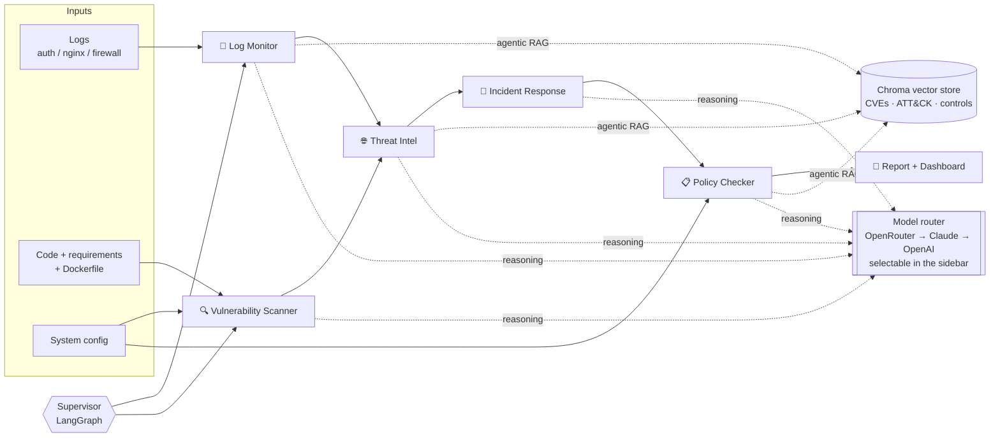

# SecAgents: a multi-agent Cyber Security AI system

Five AI agents that monitor logs, look up threats, scan for vulnerabilities, plan the incident
response and check compliance, orchestrated with **LangGraph** and grounded with **agentic RAG**
over CVE, MITRE ATT&CK and NIST / ISO 27001 / SOC 2 knowledge. Works with **Claude, OpenAI and
OpenRouter**, with automatic failover between them.

| Agent | What it does |
|---|---|
| 📜 **Log Monitor** | Parses auth, web and firewall logs. Detects brute force and password spraying, login-after-brute-force, privilege escalation, backdoor accounts, SQLi / path traversal / XSS / command injection / Log4Shell, scanners, port scans and outbound C2 traffic. Maps each detection to MITRE ATT&CK and writes an attack narrative. |
| 🔍 **Vulnerability Scanner** | Runs Bandit SAST on code, finds hardcoded secrets, lints the Dockerfile (EOL base image, root user, secrets in ENV...), builds a software inventory, uses Trivy if installed, and suggests code fixes. |
| 🌐 **Threat Intelligence** | Answers *"are we affected?"*: version-matches the inventory against CVEs, uses agentic RAG to identify which CVE an exploit attempt targets and whether that component is deployed, correlates attacks in the logs with weaknesses in the code, and checks IOCs. |
| 🚨 **Incident Response** | Declares prioritized incidents and generates a NIST SP 800-61 playbook (analysis, containment, eradication, recovery, post-incident) with concrete commands for the actual attacker IPs, accounts and hosts. |
| 📋 **Policy Checker** | Evaluates 20 technical checks against 40 controls in NIST 800-53, NIST CSF 2.0, ISO 27001:2022 and SOC 2; scores each framework and writes a remediation roadmap ranked by how many controls each fix closes. |

## Architecture



- **Supervisor graph** (`secagents/graph.py`): a LangGraph `StateGraph` where a supervisor node routes to whichever agent's dependencies are satisfied, then hands off to the reporter.
- **Agentic RAG** (`secagents/rag/`): retrieve from Chroma, let the LLM grade relevance, rewrite the query and retry once. Embeddings use OpenAI when a key is set, otherwise a local hashed embedding.
- **Model router** (`secagents/llm.py`): tries providers in `LLM_PROVIDER_ORDER` (default `openrouter,anthropic,openai`); the sidebar **LLM provider** dropdown (default OpenRouter) moves the chosen one to the front and shows its model from `.env`. Claude calls use `claude-opus-5-5` with server-side refusal fallbacks, so security content that trips a classifier is rerouted instead of failing.
- **Deterministic first, LLM second**: every agent detects with explainable rules, then uses the LLM for correlation, narrative and remediation. With no keys the whole pipeline still runs.

## Quick start

```bash
python -m venv .venv && source .venv/bin/activate
pip install -r requirements.txt
cp .env.example .env        # add ANTHROPIC_API_KEY / OPENAI_API_KEY / OPENROUTER_API_KEY

streamlit run app/streamlit_app.py     # dashboard
python -m secagents --json results.json  # CLI: writes security_report.md
pytest                                  # 20 tests, no API keys needed
```

The CLI accepts your own data: `python -m secagents --logs /var/log/auth.log access.log --code ./src --requirements requirements.txt --dockerfile Dockerfile --config my_config.yaml`.
The dashboard also has an **Upload my own files** mode, a **Scan a whole folder** option (type a path or press **Browse...**; `.gitignore` / `.ignore` rules are honoured and a comma-separated box excludes extra folders) and an **Ask** tab for questions such as *"Are we affected by Log4Shell?"*.

Every assessment is saved to `.history/` (set `HISTORY_DIR` to move it) and listed under **Scan history** in the sidebar, using the name you give it or an automatic one (source, time, risk). Click a scan to reopen it. **Reset**, under the title, clears the current results, chat and inputs; saved history is kept.

## The demo scenario

`samples/` contains a seeded attack story (regenerate with `python samples/generate_logs.py`):

1. `192.0.2.77` port-scans the server, runs sqlmap and Nikto, then tries SQL injection, path traversal, command injection, XSS and a Log4Shell JNDI string.
2. `203.0.113.45` brute-forces SSH, logs in as `admin`, runs a root shell, creates a UID 0 user `sysupdate` and downloads a script from `203.0.113.99`.
3. The server opens a connection to `203.0.113.99:4444` and sends 48 MB out.

`samples/vulnerable_app` is a deliberately vulnerable Flask app with old dependencies and a bad Dockerfile, and `samples/config/system_config.yaml` describes the environment's security settings.

Expected outcome: overall risk **CRITICAL**, 3 incidents (SSH compromise P1, web exploitation P1, vulnerable components P2), the SQL injection, path traversal and command injection attacks matched to the exact vulnerable lines in `app.py`, Log4Shell correctly reported as *attempted but not affected*, 9 CVEs in the inventory, and compliance scores between roughly 20% and 45%.

## Project layout

```
secagents/
  agents/        log_monitor, vuln_scanner, threat_intel, incident_response, policy_checker
  rag/           Chroma knowledge base + agentic retriever
  graph.py       LangGraph supervisor
  llm.py         Claude / OpenAI / OpenRouter router
  repo_scan.py   Folder scan: ignore rules, exclusions, staging
  report.py      Markdown report
  qa.py          Ask-the-agents Q&A
knowledge/       cves.jsonl, attack.jsonl, controls.jsonl, threat_feed.json
samples/         demo logs, vulnerable app, system config
app/             Streamlit dashboard
tests/
```

## Extending

- **More CVEs**: append to `knowledge/cves.jsonl` (`affected` takes specifiers like `>=2.0,<2.15.0`), or load an NVD export into the same shape.
- **New detections**: add a parser or rule in `secagents/agents/log_monitor.py`.
- **New controls**: add a line to `knowledge/controls.jsonl` naming the checks that evidence it, and a check in `policy_checker.py` if needed.

> All IP addresses are from RFC 5737 documentation ranges. The vulnerable app exists only to be scanned: do not deploy it.

## Requirements checklist

Requirement: *an AI-powered cybersecurity system made of multiple agents that monitor logs, find security issues and suggest fixes automatically, showing how RAG and AI agents work together for threat detection, analysis and response.*

| # | Requirement | Status | Where / how |
|---|---|---|---|
| 1 | **Log Monitor Agent**: reads system and network logs, detects unusual activity or attacks | ✅ | `agents/log_monitor.py`: auth, web and firewall logs; brute force, spraying, privilege escalation, backdoor accounts, web attacks, scanners, port scans, C2 traffic; MITRE ATT&CK mapping |
| 2 | **Threat Intelligence Agent**: looks up known threats (CVE data, reports) | ✅ | `agents/threat_intel.py`: CVE and ATT&CK knowledge base (`knowledge/`), IOC feed, agentic RAG |
| 3 | ...and checks if your system is affected | ✅ | Version-matches the software inventory against CVEs and correlates log attacks with weaknesses in the code |
| 4 | **Vulnerability Scanner Agent**: scans code | ✅ | Bandit SAST, regex fallback rules, hardcoded-secret scan |
| 5 | ...scans Docker images | 🟡 | Dockerfile lint (EOL base image, root user, secrets in `ENV`, unpinned tags) and dependency CVEs. Trivy runs on the source folder when installed. A built image is not pulled or scanned |
| 6 | ...scans APIs | 🟡 | The API's source code is scanned, and attacks on it are found in access logs. No live endpoint or OpenAPI spec scanning |
| 7 | **Incident Response Agent**: step-by-step action plans when an issue is found | ✅ | `agents/incident_response.py`: prioritized incidents and a NIST SP 800-61 playbook with commands for the actual IPs, accounts and hosts |
| 8 | **Policy Checker Agent**: checks setup against ISO, NIST, SOC 2 | ✅ | `agents/policy_checker.py`: 20 checks, 40 controls across NIST 800-53, NIST CSF 2.0, ISO 27001:2022, SOC 2 |
| 9 | ...and shows where you need fixes | ✅ | Per-control PASS / PARTIAL / FAIL, framework scores, gaps ranked by controls closed, remediation roadmap |
| 10 | Multiple agents working together | ✅ | LangGraph supervisor (`graph.py`) runs agents in dependency order |
| 11 | RAG and agents working together | ✅ | Chroma store with an agentic retriever that grades results, rewrites the query and retries (`rag/`) |
| 12 | Real-time threat detection, analysis and response | 🟡 | The agent run streams live in the dashboard (animated current agent, trace). Logs are analysed per run, not tailed continuously |
| 13 | Suggest fixes automatically | ✅ | Code fix suggestions, incident playbook, compliance roadmap, all LLM-written with rule-based fallbacks |
| 14 | Useful for security engineers, DevOps and IT teams | ✅ | Streamlit dashboard, CLI (`python -m secagents`), Markdown and JSON report export, folder scan, scan history |

✅ implemented · 🟡 partly implemented · ❌ not implemented

## FAQs

### General

**What does this project do?**
It runs five cooperating AI agents over your logs, code, dependencies, Dockerfile and system config. They detect attacks, check whether known CVEs affect you, scan for weaknesses, plan the incident response and score compliance, then produce one report and a dashboard.

**Who is it for?**
Security engineers, DevOps and IT teams who want to see how GenAI can automate triage, analysis and remediation planning.

**Do I need an API key?**
No. Every agent detects with rule-based logic first and uses the LLM only for correlation, write-ups and suggestions. With no key (or `SECAGENTS_OFFLINE=1`) the whole pipeline still completes, with plainer text. Any one of the three providers is enough.

**Is it an audit or a certified scanner?**
No. It is a demonstration. Detections, the CVE list (16 entries) and the control library (40 controls) are small, curated and indicative. Do not use the scores as audit evidence.

### The agents

**How do the agents work together?**
A LangGraph supervisor runs whichever agent has its dependencies satisfied: Log Monitor and Vulnerability Scanner first, then Threat Intelligence (needs both), then Incident Response, then Policy Checker, then the reporter.

**How does the Log Monitor detect attacks?**
It parses auth, web and firewall logs and applies explainable rules: failed-login bursts, a successful login after brute force, privilege escalation, new UID 0 accounts, SQLi / path traversal / XSS / command injection / Log4Shell strings, scanner user agents, port scans and large outbound transfers. Each event gets MITRE ATT&CK IDs and evidence lines.

**How does Threat Intelligence decide "are we affected?"**
It version-matches the software inventory (from `requirements.txt` and the config) against CVE records. For exploit attempts in the logs, agentic RAG identifies the CVE being targeted and checks whether that component is actually deployed. Log4Shell in the demo is reported as *attempted but not affected* because the app doesn't use Log4j.

**What does the Vulnerability Scanner cover?**
Python code (Bandit, plus regex rules for what Bandit misses), hardcoded secrets, Dockerfile problems, and a dependency inventory. Trivy results are added when the `trivy` binary is installed.

**Can it scan Docker images or APIs?**
Partly. It lints the Dockerfile and scans the source. It does not pull or scan a built image, and it does not probe a running API or read an OpenAPI spec. API attacks are still detected from access logs.

**What does the Incident Response Agent produce?**
Prioritized incidents (P1, P2...) and a NIST SP 800-61 playbook covering analysis, containment, eradication, recovery and post-incident, with commands built from the real attacker IPs, accounts and hosts. Steps marked 🤖 were suggested by the LLM.

**How does the Policy Checker score compliance?**
Each control lists the technical checks that evidence it. A control is PASS if all its checks pass, PARTIAL if some fail and FAIL if all fail. A framework score is `100 x (pass + 0.5 x partial) / total`. Failed checks become gaps ranked by how many controls each one blocks. Checks read your config YAML plus the other agents' findings, so a hardcoded secret fails the secrets controls.

**Why do config-based checks fail when I upload no config?**
They need a system-configuration YAML (see `samples/config/system_config.yaml`). Without one they report "could not evaluate" and count as failed.

### RAG and LLMs

**Where is RAG used?**
Threat Intelligence (CVE and ATT&CK lookup), the Policy Checker (control text for the biggest gaps) and the **Ask** tab. The retriever queries Chroma, has the LLM grade the hits, rewrites the query and retries once if they are poor.

**Which embeddings does it use?**
OpenAI embeddings when `OPENAI_API_KEY` is set, otherwise a local hashed embedding, so RAG also works offline.

**Which LLM providers are supported and how does fallback work?**
OpenRouter, Anthropic (Claude) and OpenAI. The default order is `openrouter,anthropic,openai` (`LLM_PROVIDER_ORDER`). If a provider has no key, fails or refuses, the next one is tried; if all fail, the agent uses its rule-based output.

**How do I choose the provider and model?**
Use the **LLM provider** dropdown in the sidebar (default OpenRouter). The chosen provider is tried first and the others stay as fallbacks. The sidebar shows each provider's model, taken from `CLAUDE_MODEL`, `OPENAI_MODEL` and `OPENROUTER_MODEL` in `.env`.

**Why might security content be refused by Claude?**
Cyber content can trip provider classifiers. Claude calls use server-side refusal fallbacks, and the router also falls through to the next provider.

### Using the dashboard and CLI

**How do I run it?**
`streamlit run app/streamlit_app.py` for the dashboard, `python -m secagents --json results.json` for the CLI, which writes `security_report.md`. Restart Streamlit after pulling code changes, because it keeps imported modules in memory.

**How do I scan my own system?**
Pick **Upload my own files** and upload logs, code, `requirements.txt`, a Dockerfile and a config, or use **Scan a whole folder**: type a path or press **Browse...**. The folder scan finds logs, Python code, requirements, a Dockerfile and a config automatically.

**What does the folder scan skip?**
Anything matched by the folder's `.gitignore` or `.ignore`, plus `.git`. The **Exclude folders** box takes extra comma-separated names or relative paths (for example `tests, docs, build`). If the folder has no ignore file, put `.venv` and `node_modules` in the exclude box.

**Does the Browse button work on a remote server?**
It opens the folder chooser on the machine running Streamlit. That is fine locally; on a remote host, type the path instead.

**Where are results stored?**
Each assessment is saved in `.history/` (change with `HISTORY_DIR`) and appears under **Scan history**. **Reset** clears the current view but keeps history.

**What can I ask in the Ask tab?**
Questions such as "Are we affected by Log4Shell?" or "What should we do in the next hour?". The question is routed to the relevant agents' results and grounded with RAG.

### Accuracy and limits

**Is this real-time?**
The run streams live in the dashboard, with the active agent animated. Logs are analysed once per run; there is no continuous log tailing yet.

**Why was a line in my code flagged as a hardcoded password?**
The secret scanner looks for password-like names assigned to literal values. In Python files the value must be quoted, and code expressions such as f-string braces or function calls are ignored. Anything else flagged is worth a manual look.

**How do I extend it?**
Add CVEs to `knowledge/cves.jsonl`, detections to `agents/log_monitor.py`, and controls to `knowledge/controls.jsonl` with a matching check in `agents/policy_checker.py`.

**What are the main dependencies?**
LangGraph (orchestration), Chroma (vector store), Anthropic and OpenAI SDKs (OpenRouter uses the OpenAI SDK), Bandit (SAST), Streamlit, Altair and pandas (dashboard), and PyYAML.
