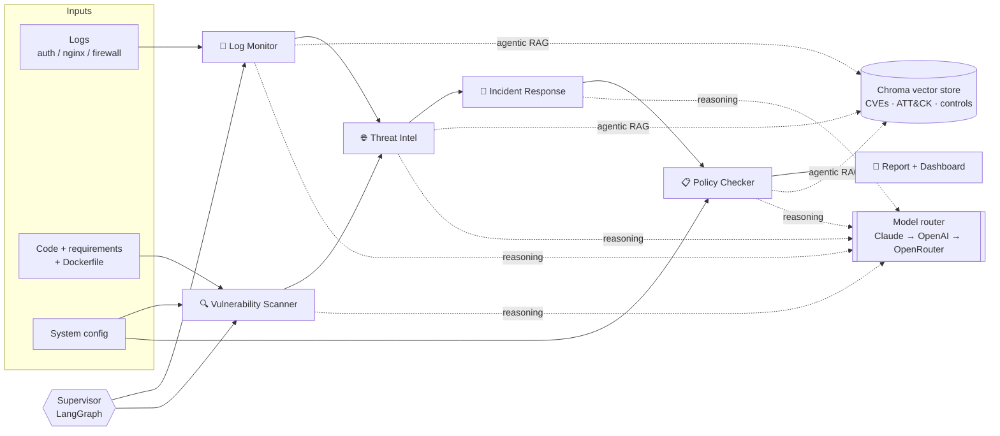

# SecAgents: a multi-agent Cyber Security AI system

Five AI agents that monitor logs, look up threats, scan for vulnerabilities, plan the incident
response and check compliance, orchestrated with **LangGraph** and grounded with **agentic RAG**
over CVE, MITRE ATT&CK and NIST / ISO 27001 / SOC 2 knowledge. Works with **Claude, OpenAI and
OpenRouter**, with automatic failover between them.

| Agent | What it does |
|---|---|
| 📜 **Log Monitor** | Parses auth, web and firewall logs. Detects brute force and password spraying, login-after-brute-force, privilege escalation, backdoor accounts, SQLi / path traversal / XSS / command injection / Log4Shell, scanners, port scans and outbound C2 traffic. Maps each detection to MITRE ATT&CK and writes an attack narrative. |
| 🔍 **Vulnerability Scanner** | Runs Bandit SAST on code, finds hardcoded secrets, lints the Dockerfile (EOL base image, root user, secrets in ENV...), builds a software inventory, uses Trivy if installed, and suggests code fixes. |
| 🌐 **Threat Intelligence** | Answers *"are we affected?"*: version-matches the inventory against CVEs, uses agentic RAG to identify which CVE an exploit attempt targets and whether that component is deployed, correlates attacks in the logs with weaknesses in the code, and checks IOCs. |
| 🚨 **Incident Response** | Declares prioritized incidents and generates a NIST SP 800-61 playbook (analysis, containment, eradication, recovery, post-incident) with concrete commands for the actual attacker IPs, accounts and hosts. |
| 📋 **Policy Checker** | Evaluates 20 technical checks against 40 controls in NIST 800-53, NIST CSF 2.0, ISO 27001:2022 and SOC 2; scores each framework and writes a remediation roadmap ranked by how many controls each fix closes. |

## Architecture



- **Supervisor graph** (`secagents/graph.py`): a LangGraph `StateGraph` where a supervisor node routes to whichever agent's dependencies are satisfied, then hands off to the reporter.
- **Agentic RAG** (`secagents/rag/`): retrieve from Chroma, let the LLM grade relevance, rewrite the query and retry once. Embeddings use OpenAI when a key is set, otherwise a local hashed embedding.
- **Model router** (`secagents/llm.py`): tries providers in `LLM_PROVIDER_ORDER`. Claude calls use `claude-opus-5-5` with server-side refusal fallbacks, so security content that trips a classifier is rerouted instead of failing.
- **Deterministic first, LLM second**: every agent detects with explainable rules, then uses the LLM for correlation, narrative and remediation. With no keys the whole pipeline still runs.

## Quick start

```bash
python -m venv .venv && source .venv/bin/activate
pip install -r requirements.txt
cp .env.example .env        # add ANTHROPIC_API_KEY / OPENAI_API_KEY / OPENROUTER_API_KEY

streamlit run app/streamlit_app.py     # dashboard
python -m secagents --json results.json  # CLI: writes security_report.md
pytest                                  # 12 tests, no API keys needed
```

The CLI accepts your own data: `python -m secagents --logs /var/log/auth.log access.log --code ./src --requirements requirements.txt --dockerfile Dockerfile --config my_config.yaml`.
The dashboard also has an **Upload my own files** mode and an **Ask** tab for questions such as *"Are we affected by Log4Shell?"*.

Every assessment is saved to `.history/` (set `HISTORY_DIR` to move it) and listed under **Scan history** in the sidebar, using the name you give it or an automatic one (source, time, risk). Click a scan to reopen it. **Reset**, under the title, clears the current results, chat and inputs; saved history is kept.

## The demo scenario

`samples/` contains a seeded attack story (regenerate with `python samples/generate_logs.py`):

1. `192.0.2.77` port-scans the server, runs sqlmap and Nikto, then tries SQL injection, path traversal, command injection, XSS and a Log4Shell JNDI string.
2. `203.0.113.45` brute-forces SSH, logs in as `admin`, runs a root shell, creates a UID 0 user `sysupdate` and downloads a script from `203.0.113.99`.
3. The server opens a connection to `203.0.113.99:4444` and sends 48 MB out.

`samples/vulnerable_app` is a deliberately vulnerable Flask app with old dependencies and a bad Dockerfile, and `samples/config/system_config.yaml` describes the environment's security settings.

Expected outcome: overall risk **CRITICAL**, 3 incidents (SSH compromise P1, web exploitation P1, vulnerable components P2), the SQL injection, path traversal and command injection attacks matched to the exact vulnerable lines in `app.py`, Log4Shell correctly reported as *attempted but not affected*, 9 CVEs in the inventory, and compliance scores between roughly 20% and 45%.

## Project layout

```
secagents/
  agents/        log_monitor, vuln_scanner, threat_intel, incident_response, policy_checker
  rag/           Chroma knowledge base + agentic retriever
  graph.py       LangGraph supervisor
  llm.py         Claude / OpenAI / OpenRouter router
  report.py      Markdown report
  qa.py          Ask-the-agents Q&A
knowledge/       cves.jsonl, attack.jsonl, controls.jsonl, threat_feed.json
samples/         demo logs, vulnerable app, system config
app/             Streamlit dashboard
tests/
```

## Extending

- **More CVEs**: append to `knowledge/cves.jsonl` (`affected` takes specifiers like `>=2.0,<2.15.0`), or load an NVD export into the same shape.
- **New detections**: add a parser or rule in `secagents/agents/log_monitor.py`.
- **New controls**: add a line to `knowledge/controls.jsonl` naming the checks that evidence it, and a check in `policy_checker.py` if needed.

> All IP addresses are from RFC 5737 documentation ranges. The vulnerable app exists only to be scanned: do not deploy it.
